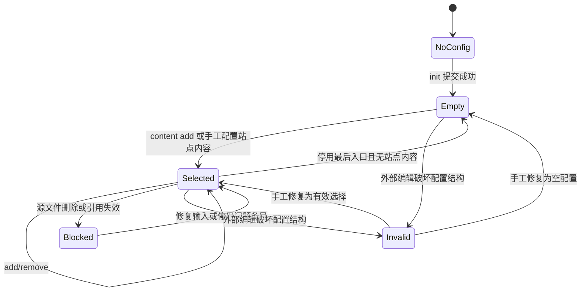

# CLI 状态机与证明边界

日期：2026-11-11；2026-11-12 补充 [结果协议](cli-protocol.md)和[事务协议](config-transactions.md)。对象是尚未实现的 [CLI 契约](cli.md) 和 [输入协议](publication.md)。结论：原契约存在反例，不能证明“程序不会出错”。按本文补全边界后，可以在列明的假设下证明若干安全性质；附带的有限模型验证不是实际 CLI 测试，也不是无限状态的机器证明。

## 1. 命令不是必须按顺序走的流水线

inspect/check/plan 都是观察操作，不会给后续命令颁发永久有效的许可。用户可以直接调用 build，但 build 必须自行完整校验。配置、磁盘文件和产物是不同状态维度，不能用一个“已检查”标志代表全部。



图只展示配置视角；输出不随 remove 自动消失，远端也不随本地命令变化。inspect 对任意可读源库可用；list 仅需配置结构有效；check/plan 结果可能是空、阻断、未完成或可构建。图中 Blocked 不是禁止所有命令的全局锁定状态。

## 2. 数学模型

全局状态记为 `Σ = (C, V, B, D, T)`：

| 符号 | 定义 |
| --- | --- |
| C | 指定配置的字节与版本，或不存在；可解析不等于有效 |
| V | 输入文件路径、实际文件身份、字节及版本的映射，包括正文和附件，不重复包含 C，也不包含输出/事务文件 |
| B | 已提交的本地构建版本及其来源快照；可不存在 |
| D | 远端部署状态；本轮本地命令均不写它 |
| T | 本次命令的读集、候选配置、暂存产物、提交阶段；不是用户维护的第二份配置 |

定义：

```text
W(C)       := 配置满足版本、类型、字段、词法路径、ID/路由唯一性规则
A(C)       := {e.source | e ∈ C.publication.entries ∧ e.publish = true}
P(C)       := {p.source | p ∈ C.site.pages ∧ p.publish = true}
S(C)       := profile 非 null 或 friends 非空
Nonempty(C):= A(C) ≠ ∅ ∨ P(C) ≠ ∅ ∨ S(C)
X          := 一次命令捕获的配置与相关文件字节、路径索引、工具版本
Deps(X)    := 从 A(X.C)、P(X.C)、显式资料出发解析出的支持资源
Ready(X)   := W(X.C) ∧ Nonempty(X.C) ∧ 所有必需检查完成且通过
Allowed(X) := A(X.C) ∪ P(X.C) ∪ Deps(X) ∪ 允许公开的资料字段
```

Allowed 表示内容来源集合，不是说输出只能有这些文件名。主题代码、导航和搜索索引也是产物，但不得包含 Allowed 以外的用户正文或任意配置字段。未公开文档可以参与路径索引，正文不能进入产物；声明公开的正文自身写了什么属于用户授权范围。

命令是带守卫的转换 `Σ --command/result--> Σ'`。环境编辑是独立转换 `Σ --edit--> Σ'`，不能把用户改文件造成的变化算作工具违反只读，也不能假定外部编辑永远产生合法配置。

## 3. 必须明确的假设

- **H1 文件系统**：可可靠读取文件身份；提交适配层提供原子发布新配置/构建版本的能力。进程中断后逻辑版本只能是旧或新，不是半份内容。具体 Windows 文件操作、断电持久化和恢复能力仍需实现验证；不从“调用 rename”直接推出这些保证。
- **H2 写入隔离**：所有 Corkoro 配置写入者以同一规范配置路径槽位串行化（稳定锁载体，不锁会被替换的配置 inode），锁覆盖读取、校验、提交；输出写入者以实际输出身份串行化。手工编辑器/同步软件不一定遵守锁，因此不支持它们与配置写命令同时修改同一配置。版本复核只能发现已观测到的变化，不能消除不合作写入者的最后时刻竞争。
- **H3 输入快照**：依赖校验和渲染使用同一批已捕获字节与解析结果，渲染器不能重读活跃 Vault。读取时发现变动则失败，不产生“完整通过”。这不是任意多文件原子快照的证明；若需要整库某一瞬间的一致版本，调用方须暂停编辑/同步或提供不可变输入快照。
- **H4 路径稳定**：路径解析、打开、提交之间不能被未受控进程替换为指向别处的 junction/链接。实际实现需用文件身份复核和安全打开满足要求；仅字符串前缀检查不满足它。主动恶意的本地进程、损坏磁盘和内核不在模型内。
- **H5 规则实现正确**：解析、资源白名单、页面转义、渲染及 JSON 校验符合协议；它们尚未实现，本状态机不能代替各自的实现证明。
- **H6 身份历史**：停用保留条目；用户手工改配置时保留原 ID，不把旧 ID 分配给另一篇文章。当前没有独立永久身份登记库，彻底删条目后再复用 ID 的行为无法从当前配置检出。

任一假设不满足就不能引用下面的证明。特别是“任意编辑器并发写入也绝不丢更新”和“任意故障下绝不出错”不是首版承诺。

## 4. 转换表与错误语义

校验拆为：结构校验 W、当前操作的局部前置条件、完整构建校验 Ready。配置路径本身的安全读写始终需要验证；不把其它资源损坏变成无法停用条目的理由。

| 命令 | 成功守卫 | 状态变化 | 常见失败 |
| --- | --- | --- | --- |
| inspect | 格式受支持，声明范围可读取 | C/V/B/D 不变；返回观察结果 | IO 或范围不安全；部分 inventory 不能冒充完整扫描 |
| init | 源根合法；目标配置不存在；输入输出隔离；可安全创建 | 原子创建 W(C)，A/P 为空、profile=null、friends=[] | 目标已存在，包括损坏配置；并发初始化只能一个提交 |
| content list | W(C)，可安全读取配置 | 不变；列出停用项 | 配置缺失/格式非法；不要求文章当前存在 |
| content add | W(C)；指定正文存在且安全；候选配置满足 W | 仅改目标 entry；同身份恢复，新增生成唯一 ID | 路径不存在、ID/路由冲突、并发配置冲突 |
| content remove | W(C)；ID 存在于文章清单 | 仅设 publish=false；已停用则不变 | 未知 ID；不能把页面 ID 当文章 ID |
| check | 可读取配置；按已实现层次检查 | 不变；返回错误或分范围结果 | 结构/路径/内容错误；必需检查未完成则不得宣称 ready |
| plan | 完整规划能力已实现；输入可检查 | 不变；可以返回阻断报告 | 功能未实现、内容阻断；完全空是成功报告但 buildable=false |
| build（后续） | Ready(X)；目标输出可安全提交 | 暂存成功后一次提交 B'；C/V/D 不变 | 空内容、缺检查、引用错误、输出被占用、生成失败 |

add 的“相同”包括 source、slug 和显式给定的 ID；冲突必须失败。即使条目已启用，add 仍检查目标源是否存在。remove 不检查正文是否存在，也不要求其它启用文章没有坏链；它可能使某个仍启用文章的引用失效，这是下一次 check 的内容错误。无效 JSON/重复 ID 等结构错误仍须先手工修复，CLI 不猜测修复方式。

配置写入分为 `read → validateCandidate → prepare → commit → acknowledge`。提交前失败不修改配置语义；工具拥有的临时文件可残留，不能因此覆盖/删除用户文件。提交后丢失响应，不意味着操作没发生，终止或 stdout 写入失败时可能根本没有 JSON/退出码可用。客户端必须重新 list/读取配置；add/remove 的幂等性使相同请求可安全重试。init 重试遇到 CONFIG_EXISTS 时检查现有内容，不覆盖。

构建采用 `capture → validate → stage → commit → acknowledge`。stage 不替换当前有效版本；commit 后清理旧文件失败不能伪装成“旧版本没变化”，应报告已提交及清理告警。具体版本目录、提交标记和恢复方式在 build 实现前落实。残留暂存内容不属于可预览/部署的产物。

`buildable` 的判定顺序：

```text
无法获得有效配置 / 已知阻断 / 完全空内容   => false
无已知阻断、有内容，但必需检查未完成      => null
有内容且全部必需检查通过                  => true
```

这是报告所依据输入版本的属性，不是持久权限。上次报告不能授权下一次构建；build 必须捕获并检查自己的 X。CLI 诊断、空集合和退出码仍遵循 cli.md；非正常终止不属于“必有一份 JSON”的承诺。

## 5. 不变量与归纳论证

以下是人工数学论证，未交给定理证明器检查。初始配置可以不存在，B 可以是由此前合法转换产生的版本。任意外部输入不能假定 W 成立，命令必须通过守卫处理。

**I1 源数据不被命令改写。** 对所有本地命令 `V'=V`，但指定配置 C 的显式写入不算正文写入。观察命令无写入；init/content 的写集仅含指定配置及工具事务元数据；build 写集仅含隔离输出。因此按命令长度归纳成立。H1/H4 是写集隔离在真实文件系统成立的前提。

**I2 选择不被引用或扫描扩大。** init 产生空授权；唯一自动增加文章的转换是显式 add；remove 只减少启用集合；inspect/check/plan 不改 C；build 的正文来源由 Allowed(X) 限制，引用未授权正文会阻断。逐项保持，故任意有限工具命令序列不会自行公开未选择正文。手工修改 C 是另一项显式输入，不属于工具自动选择。

**I3 内容管理保留身份和站点设置。** 对 add/remove，`C'.site=C.site`、`C'.theme=C.theme`，非目标条目不变；已有条目的 ID/slug 不变，新条目必须通过全局唯一性校验。守卫和赋值直接推出。长期评论身份依赖 H6；不能证明用户删历史后不复用 ID。

**I4 观察与本地/远端分离。** inspect/list/check/plan 不改 C/V/B/D；其它本地命令不改 D。对每项转换检查写集即可归纳。preview/deploy/comments 的内部状态转换未定义，不属于此证明。

**I5 每个已提交版本符合它自己的输入快照。** `Committed(B) ⇒ Ready(B.origin) ∧ UserSources(B) ⊆ Allowed(B.origin)`。唯一创建新 B 的转换在 Ready 后提交，只渲染 X；旧 B 保持其历史属性。注意不能改写成 `UserSources(B) ⊆ Allowed(当前 C)`：build 后 remove，旧产物仍存在，这是合法且必须明确的行为。

**I6 失败不破坏已提交版本。** 提交前故障只改变 T，C/B 保持；提交点后可能是新 C/B，但必须完整有效。由 H1/H2 和阶段写集推出。错误响应与持久状态不能强行一一对应，因 acknowledge 可能丢失。

**I7 不能把“未检查”当作“可构建”。** Ready 必须所有检查通过，且 build 不使用以前的布尔状态。按照定义，empty/blocked/incomplete 三类均无法通过 build 守卫；有页面/资料/友链但零文章的输入不被 empty 误判。

安全性质不等于保证成功。源库持续变化、磁盘不可写、锁被进程占用时，无法证明命令最终成功。只在输入稳定、依赖有限、资源充足、调度公平且实现终止的条件下，才期望一次有效请求完成；首版不等待锁，锁忙立即失败；取消、结果未知及残留载体的规则已在事务协议定义，OS 适配与异常 IO 的实际终止能力仍是实现义务。

## 6. 原契约的反例与处理

| 编号 | 反例轨迹 | 结论/处理 |
| --- | --- | --- |
| R1 | add A → 用户删除 A.md → remove A 前“完整内容校验”失败 | 拆开 W 与 Ready；remove 不依赖源文件存在 |
| R2 | 写者甲乙都读取 C0 → 都复核 C0 → 甲替换 C1 → 乙替换 C2 | 原子替换不等于原子比较并交换；合作写者从读到提交串行化，不合作编辑明确不支持并发 |
| R3 | 捕获/检查 A → 用户加入未公开嵌入 → 渲染器重读 A | 校验与渲染必须使用同一捕获字节；旧 plan 不是授权 |
| R4 | 配置提交成功 → 进程在输出 JSON 前崩溃 | 结果未知不等于未提交；重新查询并幂等重试 |
| R5 | build 含 A → remove A → preview 旧 B | remove 不是撤回产物或远端；旧 B 有历史授权，后续重新 build/deploy 才改变网站 |
| R6 | 删除最后文章，保留关于页 → 以 articleCount=0 阻止 build | 空集合须包括全部站点内容维度 |
| R7 | 彻底手删 ID=x → 给另一文档指定 x → 评论被错误关联 | 当前配置无历史证据；H6 必须成立，否则需要另设计身份登记机制 |
| R8 | 输出路径检查通过 → 外部进程把祖先换成指向 Vault 的 junction | 路径字符串校验不足；H4 与文件系统实现验证必需 |

R2/R3 在有限模型中实际产生反例；R4 的两种未知结果也被显式检查。其余由转换定义和上述具体轨迹分析，不能声称全部做过系统级故障注入。

## 7. 可执行有限模型

[模型脚本](../tools/verification/cli-state-machine.mjs) 只使用 Node 标准库，无业务依赖、磁盘写入或网络访问：

```powershell
node tools/verification/cli-state-machine.mjs
```

它枚举两个文章位置的未登记/停用/启用状态、三种配置结构状态、页面/资料/友链存在位、文件存在位、一个 A→B 引用、路径安全位和检查完成位。逐状态检查十种抽象命令及提交前故障；另枚举两个写者的调度，以及捕获/验证/渲染间的一次外部编辑。

本次在 Node v26.13.0 下检查 13,824 个抽象状态、276,480 次命令转换（含故障分支）；坏写入协议遍历 23 个状态并找到丢更新轨迹，串行协议遍历 13 个状态、两个完成次序均保留两项修改。构建模型对每种规则检查四种交错，重读规则有反例，快照规则没有。另有 3,072 次缺源文件停用成功和 224 次仅站点内容构建成功的非空覆盖。

固定文章下标代表不同 ID/路由，invalid 统一代表结构冲突；这个抽象不验证 Unicode 路由算法、UUID 碰撞、页面文件丢失、附件类型识别、实际解析器、Windows 锁或原子替换。旧 B 用任意已提交版本的占位值表示，验证保持或替换性质；不是任意文件树的全状态遍历。

脚本预期同时得到：坏的并发/重读规则有反例；修正抽象规则无反例；缺源文件仍可停用；只有站点内容也可构建。它检查有限范围内的转换与交错，不把枚举结果外推成真实程序对无限输入的正确性。

## 8. 尚不能证明的部分

build 只定义了安全义务，完整 CLI 参数、输出提交/崩溃恢复尚未实现。preview 的监听和生命周期、deploy 的版本顺序/重试/撤回、status 的终态、评论管理的权限/状态机仍只是预留能力。不能给这些未定义接口签发“无歧义、已证明”结论。

第一阶段实现时需将抽象转换对应到实际函数和故障点，验证配置写锁、缺文件停用、结构错误、幂等重试和其它字段保留。第二/三阶段补充快照读取、输出所有权、崩溃恢复、路径替换与真实渲染测试。模型检查结果和这些实现验证必须分别报告。

## 9. 七命令契约的补充分区（2026-11-12）

[结果协议](cli-protocol.md)固定输出封装、守卫顺序、检查分区、错误优先级；[配置事务协议](config-transactions.md)定义锁忙立即拒绝、提交阶段取消、未知结果与临时文件恢复。两个协议优先于本文早期的概括性说明。

新增 [协议模型](../tools/verification/cli-protocol-model.mjs)由同一检查入口运行。实际检查 25 个可达事务状态、331 条事件转换（含终态自环和不适用事件自环）、96 个 add/remove 守卫分区实例、16 个入口分区、16 种错误类别组合及 3 种锁载体状态。检查终态稳定、取消不谎称未提交、未知结果覆盖旧/新版本、已提交不回滚、锁忙不等待。原来的双写者模型只论证串行化安全，不定义实际等待策略；新协议模型才描述立即拒绝。

对于声明的谓词域，守卫互斥且覆盖；按事务阶段列出的环境事件均有结果。这是抽象契约内的覆盖证据，不是全部文件系统输入的证明。OS 互斥、规范路径槽位计算、JSON 输出校验器和实际取消机制仍需在第一阶段开发中验证；build 的输出事务仍留在后续阶段。不能把无限 IO 挂起或不合作编辑器竞争算作本模型已经解决。
